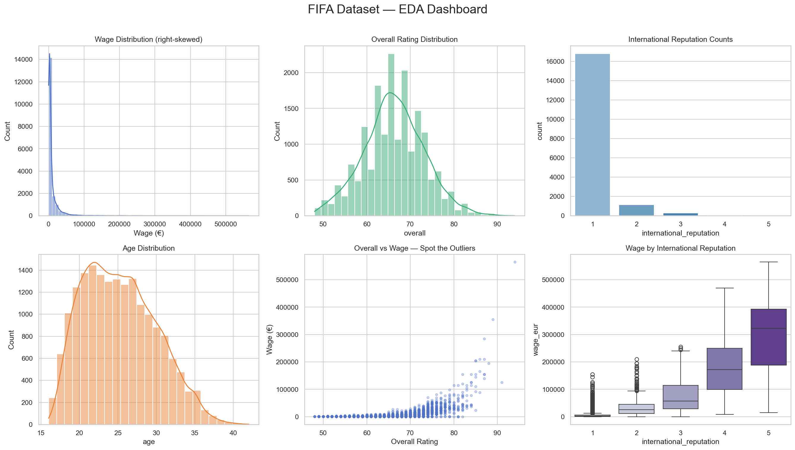
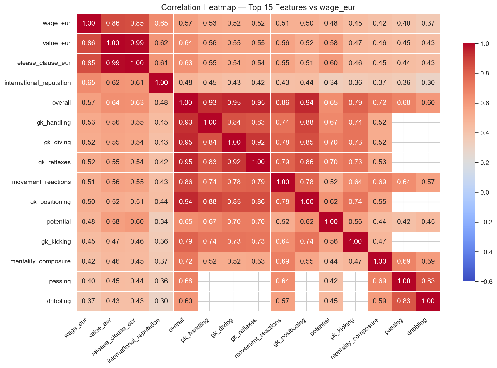

# FIFA 2020 Player Analytics & Valuation Pipeline

End-to-end exploratory data analysis, data quality audit, feature engineering, and predictive machine learning models built on the FIFA 2020 player dataset.

---

## 📁 Repository Structure

`	ext
├── 01_fifa2020_eda_and_data_quality.ipynb          # Comprehensive EDA, missing value audit & statistical profiling
├── 02_fifa2020_feature_engineering_and_modeling.ipynb  # Feature engineering, categorical encoding & ML models
├── FIFA2020_dataset.xlsx                           # Raw FIFA 2020 dataset
├── FIFA_clean_for_PowerBI.csv                      # Cleaned dataset curated for Power BI reporting
├── model_summary.csv                               # Model performance metrics & diagnostics
└── images/                                         # EDA visualizations & model diagnostics
    ├── anomaly_detection.png
    ├── clf1_reputation_binary.png
    ├── clf2_overall_3class.png
    ├── clf3_overall_binary.png
    ├── eda_dashboard.png
    ├── eda_heatmap.png
    ├── eda_nationalities.png
    ├── eda_value_vs_wage.png
    ├── reg1_feature_importance.png
    ├── reg1_wage_pred_vs_actual.png
    ├── reg2_overall_diagnostics.png
    └── target_distributions.png
`

---

## 🔍 Key Highlights & Methodology

1. **Data Quality & Forensic Profiling**:
   - Universal data profiling evaluating null density, distinct cardinality, and outlier identification.
   - Cleansed financial indicators (wages, value, release clauses) and calculated contract leverage (years until expiration).

2. **Feature Engineering**:
   - Ordinal mapping of player work rates (attacking and defensive work rates on 1–3 scale).
   - Sentiment and behavioral parsing of player_traits into positive vs. risk metrics.
   - One-hot encoding of tactical positions into macro roles (Attack, Mid, Def, GK).
   - Grouping of 160+ nationalities and clubs into top performers vs. composite baseline categories.

3. **Predictive Modeling**:
   - Regression models forecasting player wage expectations and market valuations (
eg1, 
eg2).
   - Classification models assessing international reputation tier and overall performance brackets (clf1, clf2, clf3).

---

## 📊 Visualizations

  

  

